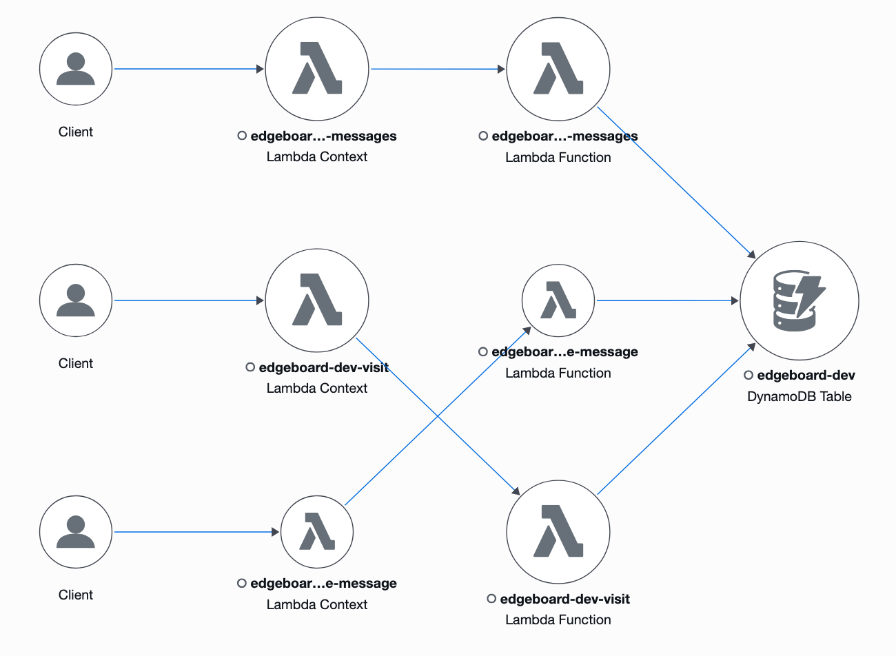
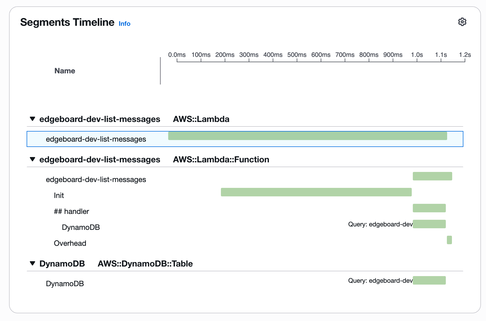

# aws-edgeboard-serverless

A full-stack interactive site built on AWS Serverless: visitor counter + guestbook. All infrastructure is managed by Terraform and deployed automatically via GitHub Actions (OIDC).

🌐 **Live demo**: https://dev.edgeboard.click

**Tech stack**: S3 · CloudFront (OAC) · API Gateway (HTTP API) · Lambda (Python 3.13, arm64) · DynamoDB · Route 53 · ACM · CloudWatch · X-Ray · Terraform · GitHub Actions

## Architecture

```
Browser ──HTTPS──> CloudFront (dev.edgeboard.click, ACM certificate @ us-east-1)
                    ├── /api/*  ──> API Gateway (HTTP API, throttled at 20 rps)
                    │                 ├── POST /api/visit      ──> Lambda visit          ──┐
                    │                 ├── GET  /api/messages   ──> Lambda list-messages  ──┼──> DynamoDB (single table)
                    │                 └── POST /api/messages   ──> Lambda create-message ──┘
                    └── /*      ──> S3 (private, OAC + SourceArn)

CloudWatch alarms ──> SNS ──> Email        X-Ray: Lambda → DynamoDB tracing

GitHub Actions ──OIDC──> IAM roles (PR: read-only plan / main: apply to dev environment) ──> Terraform
```



## Key Design Decisions

| Decision | Choice | Rationale |
|---|---|---|
| API entry point | CloudFront `/api/*` forwarding | Frontend and API share one origin, so no CORS needed; the API also gets edge TLS and Shield Standard |
| API type | HTTP API | ~70% cheaper than REST API, with lower latency (trade-off: no X-Ray support, no direct WAF attachment) |
| Counter | DynamoDB `ADD` atomic update | Tested with 20 concurrent requests: read-modify-write recorded only 15, `ADD` recorded all 20 |
| Message pagination | Query + cursor (`LastEvaluatedKey`) | No Scan; the cursor's partition is validated to prevent tampering |
| Lambda | Dedicated IAM role per function, arm64 | Least privilege; arm64 is ~20% cheaper than x86 |
| S3 access | Private bucket + OAC + `SourceArn` | Only this distribution can read the bucket, preventing the confused deputy problem |
| Certificate | ACM (us-east-1) + DNS validation | CloudFront only reads certificates from us-east-1; certificate lifetimes keep shrinking, and DNS validation enables automatic renewal |
| CI credentials | GitHub OIDC (immutable subject) | No long-lived keys stored anywhere; the `sub` includes the repository ID, guarding against repo-name squatting |
| Frontend caching | Content-hashed filenames + `immutable`; `index.html` set to `no-cache` | Static assets are cached for a year; a release only needs to invalidate `index.html` |

## Measured Results

Test setup: k6 run from GitHub Codespaces, constant rate of 10 rps for 60 seconds, `GET /api/messages`

| Metric | Value |
|---|---|
| Client P50 / P95 / P99 / Max | 24.53 / 44.05 / 730.59 / 1060 ms |
| Server-side (API Gateway) P50 / P99 | 18 / 673 ms |
| Failure rate | 0% (0 of 601 requests) |
| Lambda cold start Init (arm64 / 256 MB, from REPORT) | ~570–750 ms |
| Lambda warm handler | ~4 ms |
| First DynamoDB Query in a cold-start request (incl. TLS handshake) | ~130 ms |

P95 is only 44 ms, but P99 jumps to 730 ms, matching the cold-start Init duration: the tail latency comes almost entirely from cold starts. Provisioned Concurrency would eliminate it, but isn't cost-effective at this traffic level.



## Cost

| Item | Monthly cost | Notes |
|---|---|---|
| Route 53 hosted zone | $0.50 | Fixed charge |
| Domain edgeboard.click | $3 / year | Registration and renewal |
| CloudFront / Lambda / DynamoDB / API Gateway / S3 | $0 | Within the free tier at low traffic (current bill: $0) |
| CloudWatch alarms (6) / X-Ray | $0 | Within the free tier (10 alarms, 100,000 traces) |
| **Total** | **~$0.50 / month** | Excluding the domain |

Safeguards: AWS Budgets alert at $5/month; API throttling at rate 20 / burst 50.

## Repository Structure

```
├── frontend/              # Vanilla HTML/CSS/JS (XSS-safe rendering via textContent)
├── backend/
│   ├── src/handlers/      # Lambda: visit / list_messages / create_message
│   └── tests/             # pytest + moto (28 test cases)
├── infra/
│   ├── bootstrap/         # Terraform remote state bucket (local state, one-time)
│   ├── ci/                # GitHub OIDC provider + CI roles (one-time)
│   ├── modules/           # database / lambda_function / api / static_site / monitoring
│   └── envs/dev/          # dev environment entry point
├── scripts/               # Frontend build (content hashing), k6 load test
└── .github/workflows/     # pr.yml (tests + plan), deploy.yml (apply + frontend release)
```

## Deploying from Scratch

1. **Prerequisites**
   - An AWS account (root MFA + IAM Identity Center) and a domain registered in Route 53
   - Dev environment: GitHub Codespaces (`.devcontainer/` preinstalls AWS CLI v2, Terraform ≥ 1.10, Python 3.13)
   - Sign in to AWS: `aws sso login --use-device-code`
2. **State bucket**: `cd infra/bootstrap && terraform init && terraform apply`
3. **CI roles**: `cd infra/ci && terraform init && terraform apply`. Look up the `sub` prefix with `gh api repos/<owner>/<repo>/actions/oidc/customization/sub`
4. **GitHub configuration**
   - Variables: `AWS_PLAN_ROLE_ARN`, `AWS_APPLY_ROLE_ARN`
   - Secrets: `ALERT_EMAIL`
   - Environment `dev`: main branch only, approval required
   - Ruleset: main must pass `Backend tests` and `Terraform plan (dev)`
5. **Deploy**: open a PR → merge once checks pass → approve the deployment in Actions
6. **Confirm the SNS subscription email**

## CI/CD

| Trigger | Steps |
|---|---|
| Pull request | ruff + pytest; terraform fmt / validate / plan, with the plan posted as a PR comment |
| Merge to main | Approval → terraform apply → build frontend (content hashing) → upload to S3 → invalidate `index.html` |

## Known Limitations & Future Improvements

- The raw API Gateway endpoint (`execute-api`) is still publicly reachable, allowing CloudFront to be bypassed. Improvement: have CloudFront inject a secret header and validate it in the backend.
- The visitor counter increments on every page refresh. Improvement: count unique visitors using an IP hash + TTL.
- The apply role uses `AdministratorAccess`. Improvement: add a permissions boundary.
- In the deploy pipeline, approval happens before the plan. Improvement: split plan and apply into separate jobs.
- Only a dev environment exists so far. Improvement: add prod (apex domain, deletion protection, stricter approvals).
